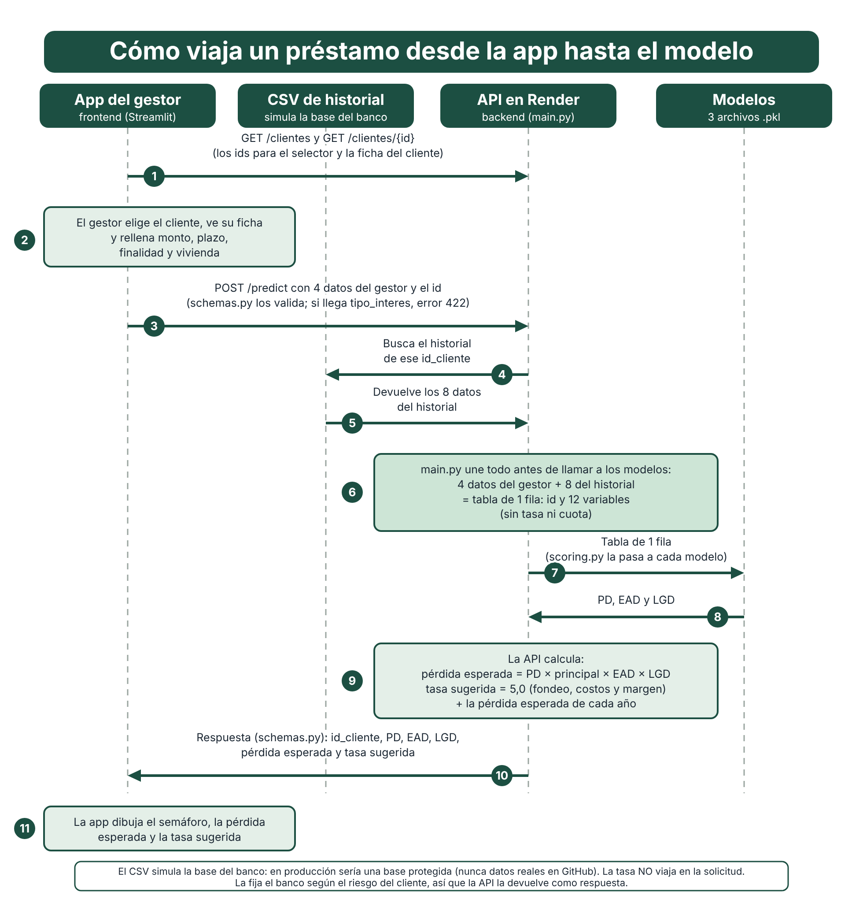
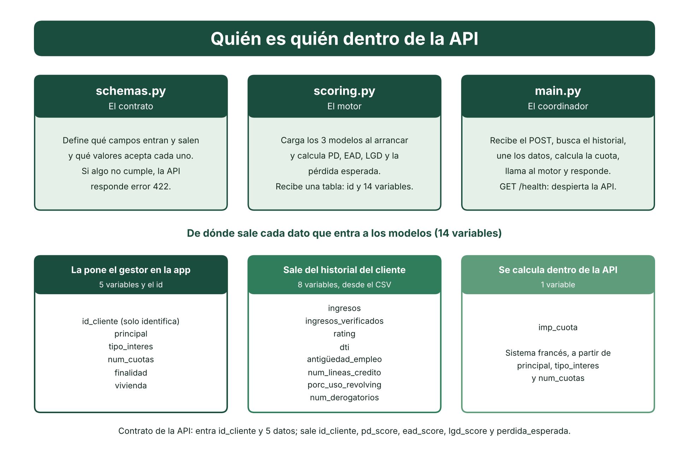
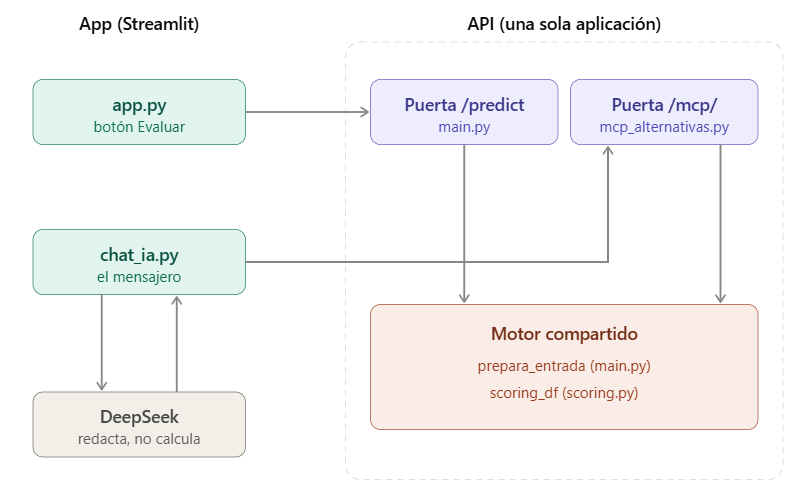

# Scoring de Riesgos de Crédito

Sistema que estima cuánto dinero se puede perder con un préstamo y a qué tasa conviene aprobarlo.

**Pérdida esperada = PD × principal × EAD × LGD**

| Pieza | Qué responde |
|---|---|
| PD (probabilidad de impago) | ¿Qué tan probable es que el cliente deje de pagar? |
| EAD (exposición al impago) | Si falla, ¿qué porcentaje del préstamo todavía debía? |
| LGD (pérdida dado el impago) | De lo que debía, ¿qué porcentaje no se recupera? |

Hay tres modelos de Machine Learning (uno por pieza), una API (FastAPI) que los sirve y una app (Streamlit) para el analista del banco. Proyecto de portafolio, hecho por Andrés Miranda.

| Servicio | Dirección |
|---|---|
| API | https://zero3-riesgos.onrender.com/docs |
| App | https://zero3-riesgos-aplicacion.onrender.com |

> **Primera visita lenta.** Render duerme los servicios gratuitos: la primera consulta puede tardar hasta un minuto en despertar la API.

## Qué hace la app

El analista busca por nombre **un cliente con perfil registrado**, ve su ficha, indica cuánto quiere prestar y a qué plazo, y la app responde:

| Resultado | Para qué sirve |
|---|---|
| Semáforo de riesgo (bajo, medio, alto) | Decisión rápida, según la probabilidad de impago |
| Probabilidad de impago, exposición y pérdida si falla | Entender de dónde sale el riesgo |
| Pérdida esperada en dinero | Cuánto se espera perder con este préstamo |
| **Tasa sugerida** | "Se puede aprobar desde X % anual" |
| Comparación 36 contra 60 meses | Ver cuál plazo pierde menos |
| Asistente de alternativas (solo en riesgo alto) | Propone montos y plazos que bajan el riesgo, con cifras de los modelos |

## Semáforo de riesgo: cortes de 8 % y 15 %

<h2 align="center">Bajo: menos de 8 %. Medio: de 8 % a 15 %. Alto: más de 15 %.</h2>

La app clasifica cada solicitud con la probabilidad de impago (PD) que devuelve la API.

| Nivel | Probabilidad de impago | Préstamos de los 200.000 puntuados |
|---|---|---|
| Bajo | menor a **8 %** | 38 % |
| Medio | de **8 %** a **15 %** | 37 % |
| Alto | mayor a **15 %** | 25 % |

Los cortes rodean la tasa base de default (11,86 %) y dejan la población repartida 38/37/25 %. Un corte en 50 % casi nunca se activaría: solo el 0,21 % de los préstamos supera esa probabilidad.

### Qué dicen los datos de cada banda

| Nivel | Préstamos | Probabilidad de impago que predice el modelo (media) | Impago real | Intervalo del 95 % del impago real |
|---|---|---|---|---|
| Bajo | 38,0 % | 5,5 % | 5,0 % | 4,8 a 5,1 % |
| Medio | 37,2 % | 11,1 % | 11,8 % | 11,6 a 12,1 % |
| Alto | 24,8 % | 22,7 % | 22,4 % | 22,0 a 22,8 % |

En cristiano: de cada 100 préstamos que el modelo marca como riesgo alto, unos 22 terminan en impago de verdad, y el modelo anunciaba casi 23. En riesgo bajo son 5 de cada 100 y en riesgo medio 12. La probabilidad que muestra la app se parece a lo que realmente pasó, y por eso los cortes separan grupos con un riesgo claramente distinto.

Si se mueven los dos cortes un punto (7 % y 14 %, o 9 % y 16 %), el impago real de cada banda cambia como máximo 1,1 puntos: los cortes no dependen de un número exacto. Lo que sí cambia es cuánta gente cae en cada nivel: cerca del 15 % de los préstamos queda a menos de un punto del corte de 8 % y cerca del 7 % del corte de 15 %. Esas solicitudes cambian de color con facilidad, por eso conviene repetir esta revisión cada vez que se reentrene el modelo.

Impago real son los préstamos cancelados como pérdida o en default. El cálculo usa los 200.000 préstamos y el modelo entrenado con todos ellos, y los préstamos vigentes cuentan como no impagos, así que el impago real podría estar algo subestimado.

Los dos cortes son constantes (`UMBRAL_BAJO` y `UMBRAL_ALTO`) al inicio de `07_despliegue/app/app.py`: si la política de riesgo es otra, se cambian ahí.

## Cómo funciona





La app no tiene lógica de Machine Learning: todo lo calcula la API.

### El asistente de alternativas



Cuando la probabilidad de impago supera 15 %, la app muestra, a la derecha del medidor de riesgo, un chat con el asistente. Al pulsar "Proponer alternativas" pasa esto:

| Paso | Quién | Qué hace |
|---|---|---|
| 1 | La app (`chat_ia.py`) | Envía la solicitud y la pregunta a un modelo de lenguaje (DeepSeek), junto con la lista de herramientas disponibles |
| 2 | El modelo de lenguaje | Pide usar una herramienta; la app la ejecuta en el servidor MCP de la API (`/mcp/`) |
| 3 | El servidor MCP (`mcp_alternativas.py`) | Prueba montos entre 10 % y 70 % menores y plazos de 36 y 60 meses con los mismos tres modelos |
| 4 | El modelo de lenguaje | Redacta la explicación con esas cifras. La tabla se dibuja con los números de la herramienta, no con el texto del modelo |

Reglas del asistente:

* Solo cambia el monto y el plazo. El cliente, la finalidad y la vivienda quedan fijos: la app los fuerza aunque el modelo de lenguaje pida otros.
* Una alternativa sirve si baja la probabilidad de impago y sale de riesgo alto. Si sigue en riesgo alto, solo se ofrece cuando su pérdida esperada no supera 2.000 dólares (`TOPE_PERDIDA_ESPERADA` en `mcp_alternativas.py`) y se avisa de que sigue en riesgo alto. Ese tope es ilustrativo: lo fija cada banco.
* El asistente no aprueba nada: la decisión es del analista.
* La clave de DeepSeek se guarda en la variable `DEEPSEEK_API_KEY`, solo en la app. Sin ella el chat no aparece y la app funciona igual.

## Supuestos y decisiones que conviene conocer

| Tema | Qué se decidió | Por qué |
|---|---|---|
| Perfil registrado | La demo busca el perfil del solicitante en una base de ejemplo. No da de alta clientes | El modelo no usa el id como predictora: solo trae la fila con el perfil (ingresos, rating, endeudamiento). En la vida real ese perfil saldría del formulario y de la central de riesgo, y el mismo modelo serviría a alguien que nunca prestó en el banco. No sirve para quien nunca tuvo ningún crédito |
| Datos de ejemplo | Los perfiles de la demo son 50 filas de la base pública de préstamos, con nombres inventados, dentro de la API | En la vida real vendrían de una base de datos protegida del banco |
| Monto | De 500 a 40.000 | Es el rango que vio el modelo al entrenar; fuera de él no se puede confiar en la predicción |
| Plazo | Solo 36 o 60 meses | Son los únicos plazos que existen en los datos (71 % a 36 y 29 % a 60) |
| Ingresos altos | Un ingreso mayor a 400.000 se puntúa como si fuera 400.000 | Los ingresos extremos distorsionan el escalado; en el entrenamiento se descartaron esos 398 préstamos |
| Vivienda | Se pide en la solicitud | El historial de la demo no la trae |
| Rating | Viene en el perfil | Se asigna al solicitar el préstamo (no es fuga). Su correlación de 0,953 con la tasa indica que el banco la usó para fijar el precio |
| Tipo de modelo | Adquisición | Solo usa variables que se conocen al conceder el préstamo |

## La tasa de interés: una decisión importante

En la primera versión el analista escribía la tasa y los modelos la usaban como predictora. Al revisarlo apareció un problema:

| Hallazgo | Detalle |
|---|---|
| Es circular | La tasa la fija el banco **a partir del riesgo** del cliente. Usarla para predecir ese riesgo es usar la respuesta como pista |
| Casi repite el rating | La correlación entre rating y tasa es 0,953 |
| Daba un resultado absurdo | El modelo aprendió que a mayor tasa menor riesgo (signo negativo): subir la tasa bajaba la PD del mismo cliente |
| Quitarla casi no cuesta | El AUC de la PD pasó de 0,7002 a 0,6976 en validación cruzada, dentro del ruido (±0,005) |

**Decisión (31/10/2026):** `tipo_interes` e `imp_cuota` (la cuota se calcula con la tasa) salen de todos los modelos. La tasa pasa a ser **una respuesta**: la API devuelve una tasa sugerida.

### Cómo se calcula la tasa sugerida

```
tasa sugerida = costo de fondeo + costos operativos + margen + pérdida esperada anual
```

| Pieza | Valor | Origen |
|---|---|---|
| Costo de fondeo | 3,0 % anual | Supuesto ilustrativo |
| Costos operativos | 0,7 % anual | Supuesto ilustrativo |
| Margen | 1,3 % anual | Supuesto ilustrativo |
| Pérdida esperada anual | `100 × pérdida esperada / principal / (plazo en años)` | Sale del modelo |

El cálculo se presenta por solicitud, pero la pérdida esperada es una estimación promedio condicionada al perfil y al préstamo; no predice cuánto perderá el banco con certeza en ese caso individual. Por eso, la tasa sugerida debe interpretarse como un precio indicativo para ese perfil, no como una predicción del resultado de una persona. Al agregar una cartera, la pérdida esperada global se obtiene sumando las pérdidas esperadas y dividiendo por el principal total: es un promedio ponderado por exposición, no el promedio simple de los porcentajes individuales.

Es una tasa **mínima** de ejemplo, no la política de un banco real: los tres supuestos son del autor y están como constantes en `07_despliegue/API/scoring.py`. No incluye la pérdida inesperada ni el capital que el banco debe reservar, ni compara con la competencia. Por eso para clientes de riesgo bajo da cerca de 5,7 %, por debajo de las tasas que aparecen en los datos históricos (5 % a 31 %). Un banco real la fijaría con tesorería y su política comercial.

## Los tres modelos y sus resultados

Datos: 200.000 préstamos. Se aparta el 30 % como reserva que no se toca hasta medir, y con el 70 % restante se limpia, explora y modela. Quedan 139.602 préstamos y una tasa de impago del 11,9 %.

| Modelo | Algoritmo | Resultado en la reserva | Lectura |
|---|---|---|---|
| PD | Regresión logística con regularización (Lasso o ElasticNet) | AUC 0,698 | Ordena el riesgo mejor que el azar: al revisar el 20 % de clientes más riesgosos se capturan el 40 % de los impagos (lift 2,0) |
| EAD | HistGradientBoosting | Error medio (MAE) 0,161 | Predice casi siempre entre 60 % y 75 %; sirve para el caso típico, no para los extremos |
| LGD | HistGradientBoosting | Error medio (MAE) 0,089 | Equivale a asignar un valor fijo cercano al 89 % |

Todos los modelos son sencillos a propósito: con las variables que se conocen al conceder el préstamo, los modelos más complejos no mejoran el resultado.

Ejemplo del cliente de demostración (15.000 a 36 meses): PD 3,9 %, EAD 58 %, LGD 88 %, pérdida esperada 297 y tasa sugerida 5,66 %. A 60 meses, la pérdida esperada es 353 y la tasa sugerida 5,47 %.

Con los cortes del semáforo (PD menor a 8 % bajo, hasta 15 % medio, mayor a 15 % alto), los 200.000 préstamos puntuados se reparten en 38 % bajo, 37 % medio y 25 % alto.

## Primera prueba y limitaciones

Esta es una **primera prueba**, hecha para aprender y para mostrar el flujo completo, de los datos a una app desplegada. No es un sistema listo para un banco.

| Limitación | Qué significa |
|---|---|
| AUC cercano a 0,70 | El modelo de PD separa discretamente a los buenos de los malos, no con mucha fuerza |
| EAD y LGD casi constantes | Predicen valores cercanos a 66 % y 89 % para casi todos los clientes. El que ordena el riesgo es la PD |
| LGD equivale a una constante | De cada 100 impagos, 31 no recuperan nada y 35 recuperan entre 10 y 15 % de lo pendiente. El modelo no distingue quién es quién y predice el promedio. El 0 podría ser recuperación aún no registrada, pero la base no trae fechas para comprobarlo |
| Solo préstamos aprobados | Los rechazados no están en los datos: el modelo aprende solo de quienes recibieron el préstamo (sesgo de selección) |
| Sin historial crediticio | Quien nunca tuvo ningún crédito no tiene el perfil que el modelo necesita; en banca se resuelve con otras reglas |
| Datos con 2 plazos y un rango de monto | No se puede extrapolar a otros plazos ni montos |
| Tasa sugerida con supuestos ilustrativos | No reemplaza una política de precios real y excluye la pérdida inesperada |
| Asistente de alternativas | Solo cambia monto y plazo. No ofrece subir la tasa, porque el modelo no sabe cómo la tasa afecta el impago, y los montos mayores a 40.000 quedan fuera del rango del modelo. Con riesgo alto y un tope de pérdida esperada de 2.000, no todos los casos tienen alternativa |
| Cortes del semáforo | 8 % y 15 % rodean la tasa base de default (11,86 %); cada banco los fija según su política de riesgo |
| Clientes ficticios | La demo no usa datos reales de clientes |

## Aviso sobre datos

El CSV de perfiles de la carpeta de la API contiene **filas de la base pública de entrenamiento con nombres inventados**: no son clientes reales. Subir datos reales de clientes a un repositorio público no es aceptable: en producción el historial se consulta en una base de datos protegida. Los datos originales de entrenamiento y la reserva no se suben (ver `.gitignore`).

## Estructura del repositorio

| Carpeta | Contenido |
|---|---|
| `01_Documentos/` | Bitácora, diccionario de datos y plantillas |
| `02_datos/` | Datos originales, reserva y tablones de entrenamiento (no se suben) |
| `03_notebooks/` | Importación, calidad, EDA, transformación, modelización (07 PD, 08 EAD, 09 LGD) y preproducción (10) |
| `04_scripts/` | Funciones reutilizables (`utils.py`) |
| `06_resultados/` | Un informe en Markdown por fase |
| `07_despliegue/` | Scripts de reentrenamiento y scoring, API (`API/`, con el servidor MCP) y app (`app/`, con el chat) |
| `docs/` | Diagramas |

Informes por fase: `06_resultados/` (calidad de datos, EDA, transformación, preselección, modelización, preproducción, API y app).

## Cómo ejecutarlo en local

Necesita [uv](https://docs.astral.sh/uv/) y Python 3.12 o superior. Dos terminales abiertas a la vez:

| Terminal | Carpeta | Comando |
|---|---|---|
| 1, la API | `07_despliegue/API` | `uv run --with fastmcp==4.2.0 uvicorn main:app --reload` |
| 2, la app | `07_despliegue/app` | `uv run --with fastmcp==4.2.0 --with openai==3.50.0 streamlit run app.py` |

La API queda en http://127.0.0.1:8000 (`/docs` muestra la documentación). Para probar el asistente hace falta `DEEPSEEK_API_KEY` en un archivo `.env` en la raíz del proyecto (no se sube) o como variable de entorno. La app lee la dirección de la API de la variable de entorno `API_BASE_URL`; si no existe, usa la local.

Ejemplo de llamada a la API:

```json
POST /predict
[{"id_cliente": 4155468, "principal": 15000, "num_cuotas": 36,
  "finalidad": "debt_consolidation", "vivienda": "MORTGAGE"}]
```

```json
[{"id_cliente": 4155468, "pd_score": 0.0387, "ead_score": 0.583,
  "lgd_score": 0.880, "perdida_esperada": 297.41, "tasa_sugerida": 5.66}]
```

Si se envía `tipo_interes` u otro campo no previsto, la API responde 422.

**Búsqueda de clientes.** `GET /clientes/buscar?q=maria&tamano=10&pagina=1` devuelve las coincidencias por nombre, paginadas. La lista completa `GET /clientes` es solo de demostración.

**Clave de acceso, opcional.** Si se define la variable de entorno `API_KEY`, todas las rutas menos `/health` exigen la cabecera `X-API-Key` (sin ella, 401); la puerta del MCP (`/mcp/`) también la exige. En la demo pública está apagada para que cualquiera pueda probarla; la app envía la clave si tiene su propia variable `API_KEY`.

## Cómo reentrenar y volver a puntuar

Con los datos originales en `02_datos/01_Originales/prestamos.csv` y la reserva en `02_datos/02_Validacion/`:

```
uv run python 07_despliegue/01_reentrenamiento.py
uv run python 07_despliegue/02_produccion_scoring.py --input <prestamos.csv> --output <scoring.csv>
```

El primero busca hiperparámetros, mide una sola vez con la reserva y guarda los tres artefactos `.pkl`. El segundo puntúa un CSV de préstamos. Para publicar los modelos nuevos hay que copiar los tres `.pkl` a `07_despliegue/API/` y hacer push.

## Cómo desplegar en Render

| | API | App |
|---|---|---|
| Root Directory | `07_despliegue/API` | `07_despliegue/app` |
| Build Command | `pip install -r requirements.txt` | `pip install -r requirements.txt` |
| Start Command | `uvicorn main:app --host 0.0.0.0 --port $PORT` | `streamlit run app.py --server.port $PORT --server.address 0.0.0.0` |
| Variables | `PYTHON_VERSION=3.12.13` (y `API_KEY`, opcional) | `PYTHON_VERSION=3.12.13`, `API_BASE_URL=https://zero3-riesgos.onrender.com` y `DEEPSEEK_API_KEY` (y `API_KEY` con el mismo valor que la API, si se activa) |

Primero se despliega la API y después la app.

## Tecnologías

Python 3.12, pandas, scikit-learn, FastAPI, FastMCP, Pydantic, Streamlit, Plotly, DeepSeek (asistente) y Render. Entorno gestionado con uv.
