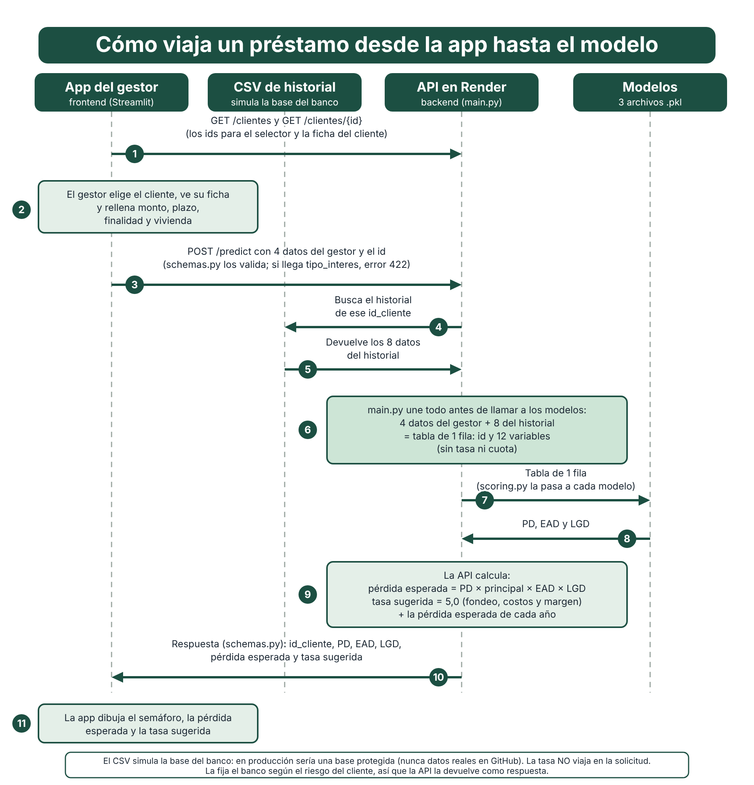
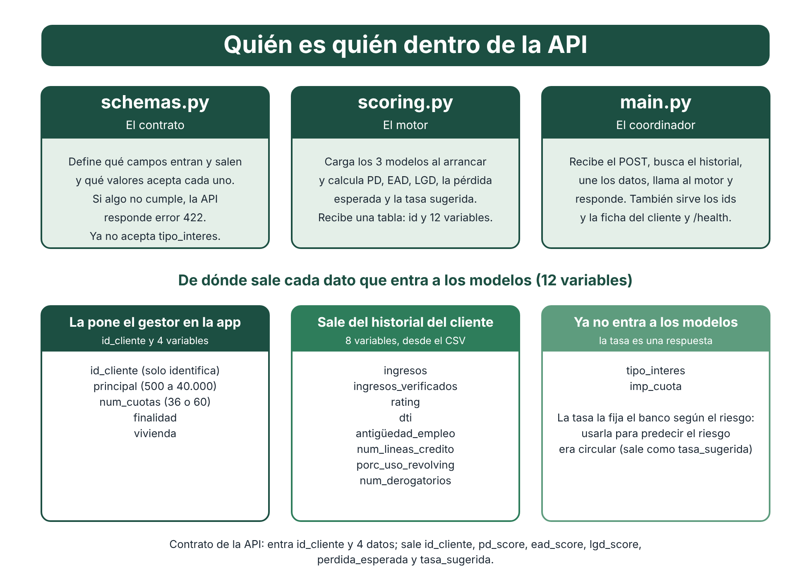

# Scoring de Riesgos de Crédito

Sistema que estima cuánto dinero se puede perder con un préstamo y a qué tasa conviene aprobarlo.

**Pérdida esperada = PD × principal × EAD × LGD**

| Pieza | Qué responde |
|---|---|
| PD (probabilidad de impago) | ¿Qué tan probable es que el cliente deje de pagar? |
| EAD (exposición al impago) | Si falla, ¿qué porcentaje del préstamo todavía debía? |
| LGD (pérdida dado el impago) | De lo que debía, ¿qué porcentaje no se recupera? |

Hay tres modelos de Machine Learning (uno por pieza), una API (FastAPI) que los sirve y una app (Streamlit) para el analista del banco. Proyecto de portafolio, hecho por Andrés Miranda.

| Servicio | Dirección |
|---|---|
| API | https://zero3-riesgos.onrender.com/docs |
| App | https://zero3-riesgos-aplicacion.onrender.com |

> **Primera visita lenta.** Render duerme los servicios gratuitos: la primera consulta puede tardar hasta un minuto en despertar la API.

## Qué hace la app

El analista elige **un cliente que ya existe en el banco**, ve su ficha, indica cuánto quiere prestar y a qué plazo, y la app responde:

| Resultado | Para qué sirve |
|---|---|
| Semáforo de riesgo (bajo, medio, alto) | Decisión rápida, según la probabilidad de impago |
| Probabilidad de impago, exposición y pérdida si falla | Entender de dónde sale el riesgo |
| Pérdida esperada en dinero | Cuánto se espera perder con este préstamo |
| **Tasa sugerida** | "Se puede aprobar desde X % anual" |
| Comparación 36 contra 60 meses | Ver cuál plazo pierde menos |

## Cómo funciona





La app no tiene lógica de Machine Learning: todo lo calcula la API.

## Supuestos y decisiones que conviene conocer

| Tema | Qué se decidió | Por qué |
|---|---|---|
| El cliente ya existe | La app evalúa clientes con historial en el banco. No da de alta clientes nuevos | El historial (ingresos, rating, endeudamiento) es lo que alimenta los modelos |
| Datos ficticios | El historial de la demo es un CSV con 50 clientes ficticios dentro de la API | En la vida real vendría de una base de datos protegida del banco |
| Monto | De 500 a 40.000 | Es el rango que vio el modelo al entrenar; fuera de él no se puede confiar en la predicción |
| Plazo | Solo 36 o 60 meses | Son los únicos plazos que existen en los datos (71 % a 36 y 29 % a 60) |
| Ingresos altos | Un ingreso mayor a 400.000 se puntúa como si fuera 400.000 | Los ingresos extremos distorsionan el escalado; en el entrenamiento se descartaron esos 398 préstamos |
| Vivienda | Se pide en la solicitud | El historial de la demo no la trae |
| Rating | Viene en el historial | Es la nota de riesgo de agencias, existe antes del préstamo |
| Tipo de modelo | Adquisición | Solo usa variables que se conocen al conceder el préstamo |

## La tasa de interés: una decisión importante

En la primera versión el analista escribía la tasa y los modelos la usaban como predictora. Al revisarlo apareció un problema:

| Hallazgo | Detalle |
|---|---|
| Es circular | La tasa la fija el banco **a partir del riesgo** del cliente. Usarla para predecir ese riesgo es usar la respuesta como pista |
| Casi repite el rating | La correlación entre rating y tasa es 0,953 |
| Daba un resultado absurdo | El modelo aprendió que a mayor tasa menor riesgo (signo negativo): subir la tasa bajaba la PD del mismo cliente |
| Quitarla casi no cuesta | El AUC de la PD pasó de 0,7002 a 0,6976 en validación cruzada, dentro del ruido (±0,005) |

**Decisión (31/10/2026):** `tipo_interes` e `imp_cuota` (la cuota se calcula con la tasa) salen de todos los modelos. La tasa pasa a ser **una respuesta**: la API devuelve una tasa sugerida.

### Cómo se calcula la tasa sugerida

```
tasa sugerida = costo de fondeo + costos operativos + margen + pérdida esperada anual
```

| Pieza | Valor | Origen |
|---|---|---|
| Costo de fondeo | 3,0 % anual | Supuesto ilustrativo |
| Costos operativos | 0,7 % anual | Supuesto ilustrativo |
| Margen | 1,3 % anual | Supuesto ilustrativo |
| Pérdida esperada anual | `100 × pérdida esperada / principal / (plazo en años)` | Sale del modelo |

Es una tasa **mínima** de ejemplo, no la política de un banco real: los tres supuestos son del autor y están como constantes en `07_despliegue/API/scoring.py`. No incluye la pérdida inesperada ni el capital que el banco debe reservar, ni compara con la competencia. Por eso para clientes de riesgo bajo da cerca de 5,7 %, por debajo de las tasas que aparecen en los datos históricos (5 % a 31 %). Un banco real la fijaría con tesorería y su política comercial.

## Los tres modelos y sus resultados

Datos: 200.000 préstamos. Se aparta el 30 % como reserva que no se toca hasta medir, y con el 70 % restante se limpia, explora y modela. Quedan 139.602 préstamos y una tasa de impago del 11,9 %.

| Modelo | Algoritmo | Resultado en la reserva | Lectura |
|---|---|---|---|
| PD | Regresión logística con regularización (Lasso o ElasticNet) | AUC 0,698 | Ordena el riesgo mejor que el azar: al revisar el 20 % de clientes más riesgosos se capturan el 40 % de los impagos (lift 2,0) |
| EAD | Ridge | Error medio (MAE) 0,165 | Predice casi siempre entre 60 % y 75 %; sirve para el caso típico, no para los extremos |
| LGD | Lasso o HistGradientBoosting | Error medio (MAE) 0,090 | Equivale a asignar un valor fijo cercano al 89 % |

Todos los modelos son sencillos a propósito: con las variables que se conocen al conceder el préstamo, los modelos más complejos no mejoran el resultado.

Ejemplo del cliente de demostración (15.000 a 36 meses): PD 3,9 %, EAD 58 %, LGD 88 %, pérdida esperada 297 y tasa sugerida 5,66 %. A 60 meses, la pérdida esperada es 353 y la tasa sugerida 5,47 %.

Con los cortes del semáforo (PD menor a 8 % bajo, hasta 15 % medio, mayor a 15 % alto), los 200.000 préstamos puntuados se reparten en 38 % bajo, 37 % medio y 25 % alto.

## Primera prueba y limitaciones

Esta es una **primera prueba**, hecha para aprender y para mostrar el flujo completo, de los datos a una app desplegada. No es un sistema listo para un banco.

| Limitación | Qué significa |
|---|---|
| AUC cercano a 0,70 | El modelo de PD separa discretamente a los buenos de los malos, no con mucha fuerza |
| EAD y LGD casi constantes | Predicen valores cercanos a 66 % y 89 % para casi todos los clientes. El que ordena el riesgo es la PD |
| Datos con 2 plazos y un rango de monto | No se puede extrapolar a otros plazos ni montos |
| Tasa sugerida con supuestos ilustrativos | No reemplaza una política de precios real y excluye la pérdida inesperada |
| Cortes del semáforo | 8 % y 15 % son una propuesta; deben validarse con el criterio de negocio |
| Clientes ficticios | La demo no usa datos reales de clientes |

## Aviso sobre datos

El CSV de historial de la carpeta de la API contiene **datos ficticios de demostración**. Subir datos reales de clientes a un repositorio público no es aceptable: en producción el historial se consulta en una base de datos protegida. Los datos originales de entrenamiento y la reserva no se suben (ver `.gitignore`).

## Estructura del repositorio

| Carpeta | Contenido |
|---|---|
| `01_Documentos/` | Bitácora, diccionario de datos y plantillas |
| `02_datos/` | Datos originales, reserva y tablones de entrenamiento (no se suben) |
| `03_notebooks/` | Importación, calidad, EDA, transformación, modelización (07 PD, 08 EAD, 09 LGD) y preproducción (10) |
| `04_scripts/` | Funciones reutilizables (`utils.py`) |
| `06_resultados/` | Un informe en Markdown por fase |
| `07_despliegue/` | Scripts de reentrenamiento y scoring, API (`API/`) y app (`app/`) |
| `docs/` | Diagramas |

Informes por fase: `06_resultados/` (calidad de datos, EDA, transformación, preselección, modelización, preproducción, API y app).

## Cómo ejecutarlo en local

Necesita [uv](https://docs.astral.sh/uv/) y Python 3.12 o superior. Dos terminales abiertas a la vez:

| Terminal | Carpeta | Comando |
|---|---|---|
| 1, la API | `07_despliegue/API` | `uv run uvicorn main:app --reload` |
| 2, la app | `07_despliegue/app` | `uv run streamlit run app.py` |

La API queda en http://127.0.0.1:8000 (`/docs` muestra la documentación). La app lee la dirección de la API de la variable de entorno `API_BASE_URL`; si no existe, usa la local.

Ejemplo de llamada a la API:

```json
POST /predict
[{"id_cliente": 4155468, "principal": 15000, "num_cuotas": 36,
  "finalidad": "debt_consolidation", "vivienda": "MORTGAGE"}]
```

```json
[{"id_cliente": 4155468, "pd_score": 0.0387, "ead_score": 0.583,
  "lgd_score": 0.880, "perdida_esperada": 297.41, "tasa_sugerida": 5.66}]
```

Si se envía `tipo_interes` u otro campo no previsto, la API responde 422.

## Cómo reentrenar y volver a puntuar

Con los datos originales en `02_datos/01_Originales/prestamos.csv` y la reserva en `02_datos/02_Validacion/`:

```
uv run python 07_despliegue/01_reentrenamiento.py
uv run python 07_despliegue/02_produccion_scoring.py --input <prestamos.csv> --output <scoring.csv>
```

El primero busca hiperparámetros, mide una sola vez con la reserva y guarda los tres artefactos `.pkl`. El segundo puntúa un CSV de préstamos. Para publicar los modelos nuevos hay que copiar los tres `.pkl` a `07_despliegue/API/` y hacer push.

## Cómo desplegar en Render

| | API | App |
|---|---|---|
| Root Directory | `07_despliegue/API` | `07_despliegue/app` |
| Build Command | `pip install -r requirements.txt` | `pip install -r requirements.txt` |
| Start Command | `uvicorn main:app --host 0.0.0.0 --port $PORT` | `streamlit run app.py --server.port $PORT --server.address 0.0.0.0` |
| Variables | `PYTHON_VERSION=3.12.13` | `PYTHON_VERSION=3.12.13` y `API_BASE_URL=https://zero3-riesgos.onrender.com` |

Primero se despliega la API y después la app.

## Tecnologías

Python 3.12, pandas, scikit-learn, FastAPI, Pydantic, Streamlit, Plotly y Render. Entorno gestionado con uv.
